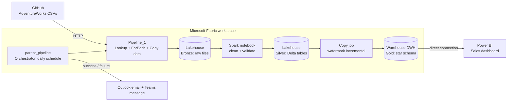
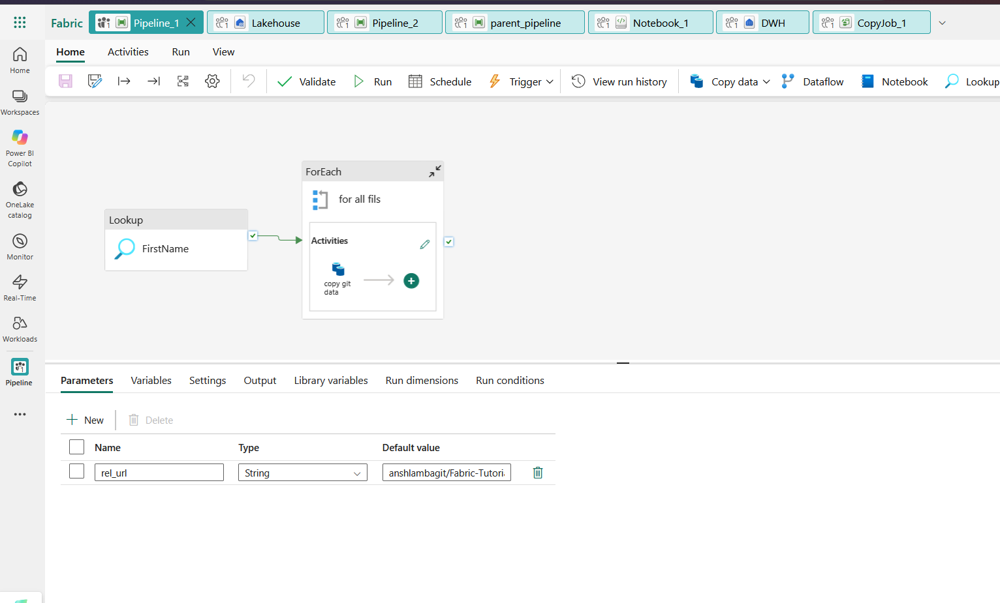
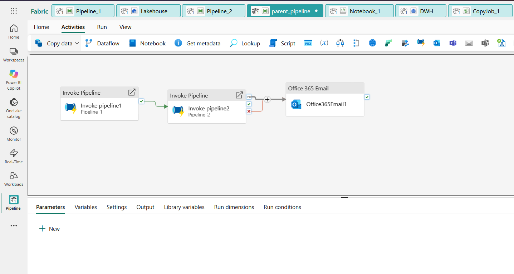
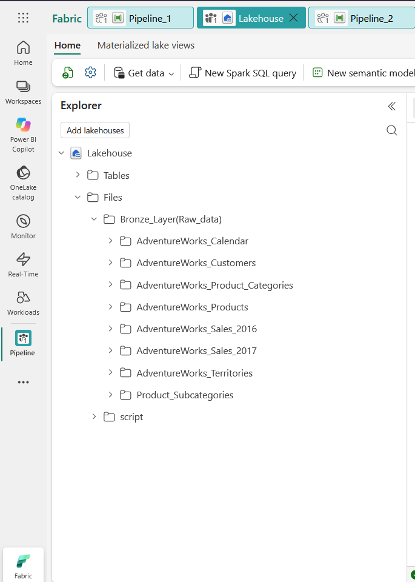
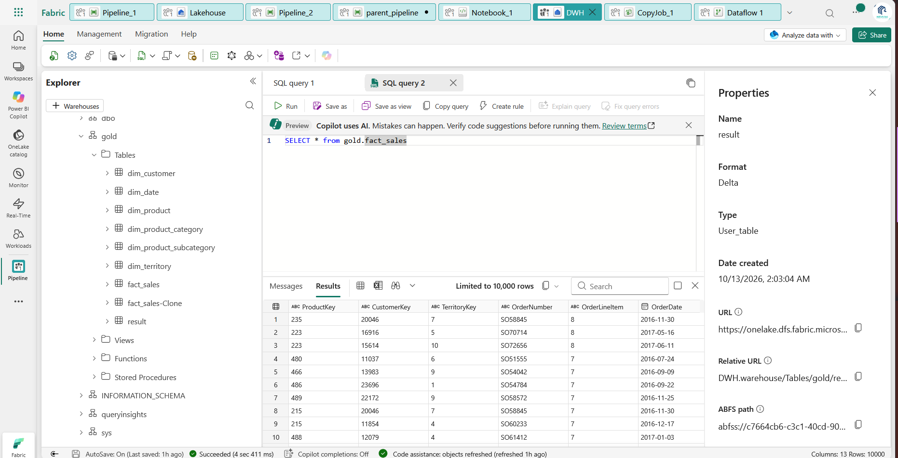
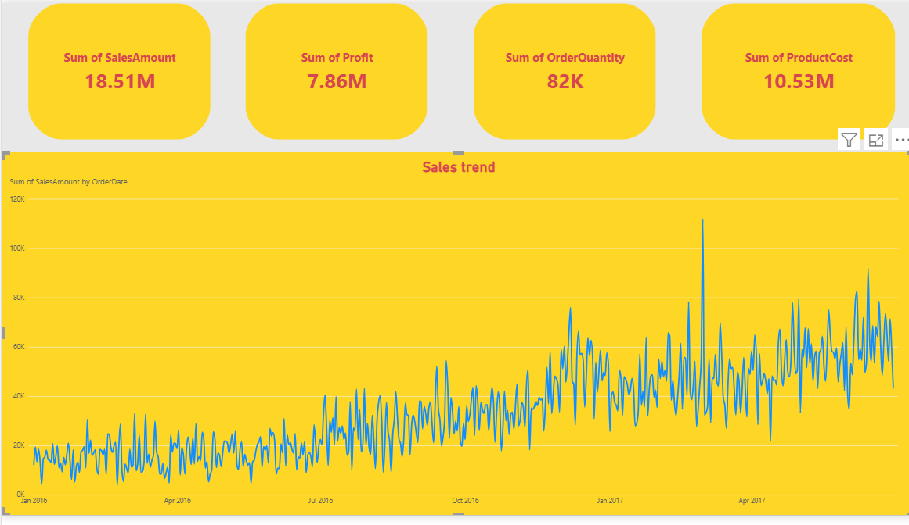
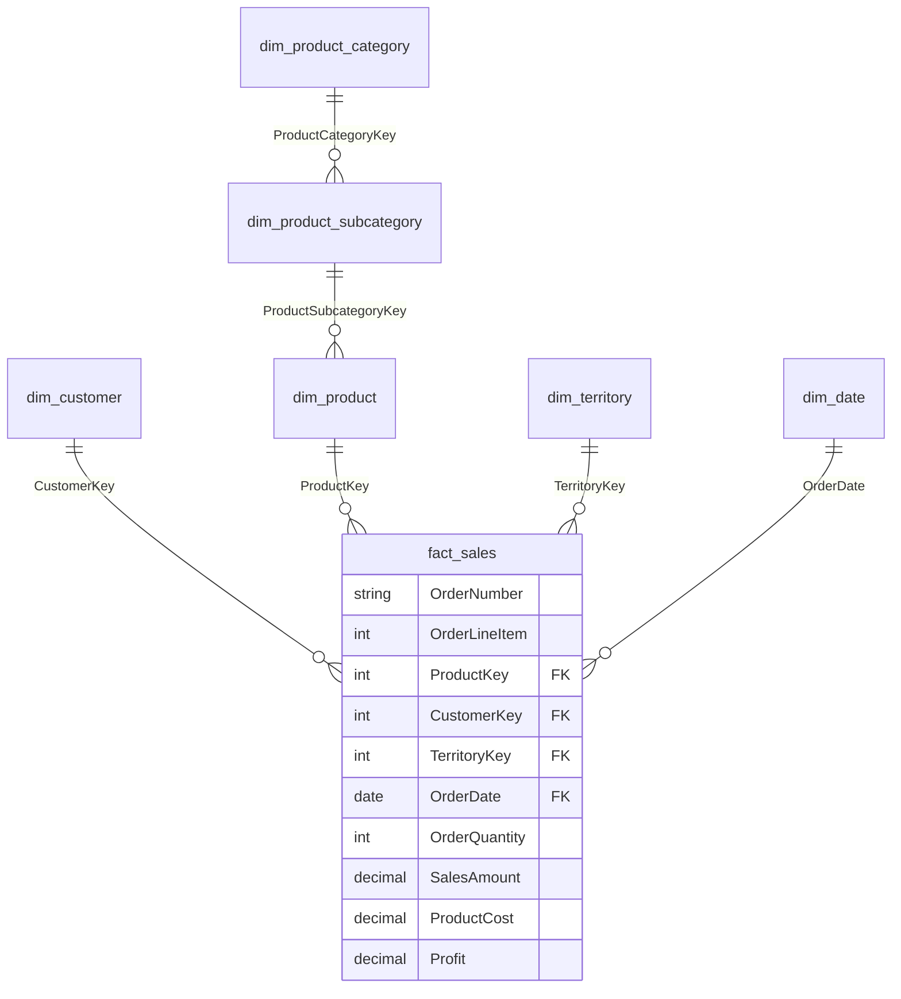

# Microsoft Fabric End-to-End Data Engineering Project: AdventureWorks Medallion Lakehouse + Warehouse + Power BI

An automated, production-style data platform built entirely inside **Microsoft Fabric**. It ingests the AdventureWorks dataset from GitHub over HTTP, lands it in a Lakehouse, refines it through a **Bronze → Silver → Gold** medallion architecture with PySpark, loads a **star schema** into a Fabric Warehouse using incremental (watermark) loading, and serves a **Power BI** sales dashboard directly from the Gold fact table. The whole flow is scheduled daily and monitored with **Outlook email and Microsoft Teams** alerts.

---

## Table of contents

1. [Business problem](#1-business-problem)
2. [Architecture](#2-architecture)
3. [Tech stack](#3-tech-stack)
4. [Data source](#4-data-source)
5. [Pipeline walkthrough](#5-pipeline-walkthrough)
6. [Orchestration and monitoring](#6-orchestration-and-monitoring)
7. [Silver layer: Spark transformations](#7-silver-layer-spark-transformations)
8. [Incremental loading (CDC / watermark)](#8-incremental-loading-cdc--watermark)
9. [Gold layer: star schema](#9-gold-layer-star-schema)
10. [Power BI dashboard](#10-power-bi-dashboard)
11. [Repository structure](#11-repository-structure)
12. [How to reproduce](#12-how-to-reproduce)
13. [Design decisions](#13-design-decisions)
14. [Future improvements](#14-future-improvements)

---

## 1. Business problem

Sales data arrives as many separate CSV files (customers, products, categories, territories, calendar, and yearly sales). Analysts cannot answer simple questions such as *"How are sales, profit and quantity trending over time?"* without first collecting, cleaning, and modelling the files by hand.

**Goal:** build a repeatable, automated pipeline that turns raw files into a trusted, analytics-ready model and a live dashboard, with no manual steps and with alerting when something fails.

---

## 2. Architecture



**Flow in one sentence:** GitHub → `Pipeline_1` → Lakehouse Bronze → Spark Silver → incremental copy → Warehouse Gold (star schema) → Power BI, all triggered and monitored by `parent_pipeline`.

### The flow in screenshots

**Step 1: Ingestion (`Pipeline_1`)**
A Lookup activity reads the file list, a ForEach loops over it, and a Copy data activity pulls each file from GitHub over HTTP. The `rel_url` pipeline parameter holds the GitHub path.



**Step 2: Orchestration and alerting (`parent_pipeline`)**
Invokes `Pipeline_1`, then `Pipeline_2`, and sends an Office 365 email with the run status. It runs on a daily schedule.



**Step 3: Bronze layer (Lakehouse)**
Raw files land unchanged in the Lakehouse, one folder per source entity.



**Step 4: Gold layer (Warehouse star schema)**
The cleaned Silver data is loaded incrementally into the `gold` schema of the Warehouse: `fact_sales` and the customer, product, product category, subcategory, territory, and date dimensions.



**Step 5: Power BI dashboard**
Power BI connects directly to the Gold fact table to show the sales KPIs and the daily sales trend.



---

## 3. Tech stack

| Layer | Technology |
|---|---|
| Platform | Microsoft Fabric |
| Ingestion | Fabric Data Pipeline (HTTP connector, Lookup, ForEach, Copy data, pipeline parameters) |
| Orchestration | Fabric pipeline with Invoke Pipeline activities and a daily schedule |
| Alerting | Office 365 Outlook activity, Microsoft Teams activity |
| Storage | OneLake: Fabric Lakehouse (Files and Delta tables) |
| Transformation | PySpark in Fabric Notebook |
| Incremental load | Fabric Copy job with watermark column |
| Serving | Fabric Warehouse (T-SQL), `gold` schema |
| BI | Power BI (semantic model on the Gold fact table) |

---

## 4. Data source

The AdventureWorks CSV files are hosted in a GitHub repository and fetched over HTTP. The Bronze folder contains one sub-folder per source entity:

```
Files/
└── Bronze_Layer(Raw_data)/
    ├── AdventureWorks_Calendar
    ├── AdventureWorks_Customers
    ├── AdventureWorks_Product_Categories
    ├── AdventureWorks_Products
    ├── AdventureWorks_Sales_2016
    ├── AdventureWorks_Sales_2017
    ├── AdventureWorks_Territories
    └── Product_Subcategories
```

---

## 5. Pipeline walkthrough

### 5.1 Ingestion: `Pipeline_1`

A metadata-driven pattern, so adding a new file never requires changing the pipeline:

1. **Parameter `rel_url`** (String) holds the relative GitHub path of the source repository.
2. **Lookup activity** reads a JSON/CSV manifest listing every file to ingest (file name and relative URL).
3. **ForEach activity** iterates over the Lookup output.
4. **Copy data activity** (inside the ForEach) pulls each file from GitHub through the **HTTP connection** and writes it to its own folder in the Lakehouse Bronze layer, unchanged.

> Why metadata-driven? One generic Copy activity replaces eight hard-coded ones, which keeps the pipeline short, reusable, and easy to extend.

### 5.2 Bronze layer: raw, as is

- Files are stored exactly as received, with no schema enforcement and no transformation.
- Bronze is the replayable source of truth: any downstream layer can be rebuilt from it.

---

## 6. Orchestration and monitoring

`parent_pipeline` is the single entry point:

```
Invoke Pipeline_1 (ingestion)
        │ on success
        ▼
Invoke Pipeline_2 (downstream processing)
        │ on completion / on failure
        ▼
Office 365 Outlook email  +  Microsoft Teams message
```

- **Schedule:** triggered daily.
- **Dependencies:** each stage runs only if the previous one succeeds.
- **Alerting:** the pipeline status is sent by Outlook email and a Teams message, so failures are seen immediately instead of being discovered in the Monitor hub.
- **Observability:** run history is available in the Fabric Monitor hub.

---

## 7. Silver layer: Spark transformations

A Fabric notebook reads the Bronze files and writes cleaned **Delta tables** to the Silver layer. Typical rules applied:

| Rule | Purpose |
|---|---|
| Derive `FullName` from first and last name | Business-friendly customer attribute |
| Drop rows with nulls in key columns | Prevent broken joins downstream |
| Drop duplicate records | Guarantee one row per entity |
| Assert `CustomerKey` is unique | Data-quality gate, fails the run if violated |
| Cast data types (dates, integers, decimals) | Correct schema for the model |

Example (adjust column names to your files):

```python
from pyspark.sql import functions as F

bronze_path = "Files/Bronze_Layer(Raw_data)/AdventureWorks_Customers"

df = (spark.read.option("header", True).option("inferSchema", True).csv(bronze_path))

# 1. Derive full name
df = df.withColumn("FullName", F.concat_ws(" ", F.col("FirstName"), F.col("LastName")))

# 2. Drop nulls on key columns and remove duplicates
df = df.dropna(subset=["CustomerKey"]).dropDuplicates()

# 3. Data-quality check: key must be unique
total = df.count()
distinct_keys = df.select("CustomerKey").distinct().count()
assert total == distinct_keys, f"CustomerKey is not unique: {total} rows vs {distinct_keys} keys"

# 4. Write to Silver as Delta
df.write.format("delta").mode("overwrite").saveAsTable("silver_customers")
```

The same pattern is applied to products, categories, subcategories, territories, calendar, and sales.

---

## 8. Incremental loading (CDC / watermark)

Instead of reloading everything on every run, a **Fabric Copy job** moves data from Silver to the Warehouse using a **watermark column**:

1. The first run performs a **full load**.
2. The job stores the highest watermark value it has loaded (for example `OrderDate` for sales).
3. Each later run copies only rows **newer than the stored watermark**.

**Benefits:** less data moved, faster runs, lower capacity cost, and the load is safe to re-run.

> Note: with a watermark approach, new and updated rows are detected through the watermark column. Hard deletes at the source are not detected unless you add a delete-handling step.

---

## 9. Gold layer: star schema

The Warehouse (`DWH`, schema `gold`) exposes a dimensional model optimised for BI:



- **Fact:** `gold.fact_sales`, one row per order line.
- **Dimensions:** `dim_customer`, `dim_product`, `dim_territory`, `dim_date`, plus `dim_product_subcategory` and `dim_product_category` for the product hierarchy.
- **Measures** such as `Profit` are computed as `SalesAmount − ProductCost`.

Quick validation query:

```sql
SELECT TOP 10 *
FROM gold.fact_sales;
```

---

## 10. Power BI dashboard

Power BI connects **directly to the Fabric Warehouse**, so the report always reflects the latest Gold data without exports or manual refresh of files.

**KPI cards**

| KPI | Value |
|---|---|
| Sum of SalesAmount | 18.51M |
| Sum of Profit | 7.86M |
| Sum of OrderQuantity | 82K |
| Sum of ProductCost | 10.53M |

**Visual:** daily **sales trend** from Jan 2016 to mid 2017, showing steady growth with a clear peak in early 2017.


---

## 11. Repository structure

```
.
├── README.md
├── docs/
│   └── images/
│       ├── pipeline_1.png
│       ├── parent_pipeline.png
│       ├── lakehouse.png
│       ├── warehouse.png
│       └── dashboard.png
├── pipelines/            # exported pipeline JSON (Pipeline_1, Pipeline_2, parent_pipeline)
├── notebooks/
│   └── silver_transformations.ipynb
├── sql/
│   └── gold_star_schema.sql
└── powerbi/
    └── sales_dashboard.pbix
```

---

## 12. How to reproduce

**Prerequisites:** a Microsoft Fabric workspace with capacity, a Power BI license, and an Outlook / Teams account for alerts.

1. **Create** a Lakehouse (`Lakehouse`) and a Warehouse (`DWH`) in your workspace.
2. **Create** an HTTP connection pointing to the GitHub raw-content host.
3. **Build `Pipeline_1`:** add the `rel_url` parameter, a Lookup over the file manifest, a ForEach, and a Copy data activity writing to `Files/Bronze_Layer(Raw_data)/`.
4. **Run the Spark notebook** to produce the Silver Delta tables.
5. **Create the Copy job** from Silver to the Warehouse with the watermark column configured.
6. **Run the SQL scripts** to create the `gold` schema, dimensions, and `fact_sales`.
7. **Build `parent_pipeline`:** Invoke Pipeline_1 → Invoke Pipeline_2 → Outlook and Teams activities, then add a **daily schedule**.
8. **Connect Power BI** to the Warehouse, build the semantic model, and create the report.

---

## 13. Design decisions

- **Medallion architecture** separates raw, cleaned, and business-ready data, which makes every step auditable and replayable.
- **Metadata-driven ingestion** (Lookup + ForEach) removes hard-coded copy steps.
- **Spark for Silver** handles cleansing and validation at scale and writes Delta for reliability.
- **Warehouse for Gold** gives analysts a familiar T-SQL star schema and a clean Power BI connection.
- **Watermark incremental loading** keeps daily runs fast and cheap.
- **Notifications on every run** turn the pipeline from a script into an operated service.

---

## 14. Future improvements

- Add `fact_sales` partitioning and a surrogate-key strategy with SCD Type 2 for `dim_customer`.
- Add automated data-quality tests with a summary table of failed checks.
- Parameterise environments (dev / test / prod) with Fabric deployment pipelines.
- Add Git integration and CI/CD for pipelines and notebooks.
- Use Direct Lake mode for the Power BI semantic model.
- Track lineage and metadata with Microsoft Purview.

---

## Author

**Mustafa Rezk**: Data Engineer
Connect with me on [LinkedIn](#) · [GitHub](#)
